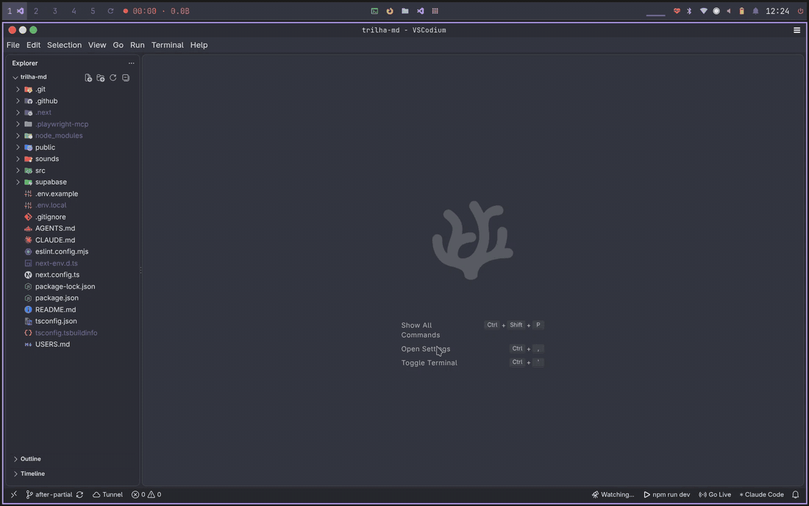

<div align="center">


# NPM Run Dev Button for Status Bar

**Start your dev server with one click.**

A convenient and lightweight status bar button for VS Code inspired by [Live Server](https://marketplace.visualstudio.com/items?itemName=ritwickdey.LiveServer). <br/> Runs `npm run dev` in a dedicated terminal and opens the app in your browser as soon as it is up.



[](./LICENSE)
[](https://code.visualstudio.com/)
[](https://developer.mozilla.org/docs/Web/JavaScript)
[](https://github.com/mateusmcamargo/npm-run-dev-button)

[](https://www.npmjs.com/)
[](https://pnpm.io/)
[](https://yarnpkg.com/)
[](https://bun.sh/)
[](https://vite.dev/)
[](https://nextjs.org/)
[](https://react.dev/)
[](https://nodejs.org/)
[](https://www.gnu.org/software/bash/)

[](https://marketplace.visualstudio.com/items?itemName=mateuscamargo.npm-run-dev-button)
[](https://marketplace.visualstudio.com/items?itemName=mateuscamargo.npm-run-dev-button)
[](https://marketplace.visualstudio.com/items?itemName=mateuscamargo.npm-run-dev-button&ssr=false#review-details)

<!-- todo: add a short demo

-->

</div>

## Features

- **One-click start:** renders the <code> npm run dev</code> button on the right side of the status bar whenever the workspace contains a `package.json`;
- **Dedicated terminal:** opens a bash terminal with customizable name, icon and color;
- **Automatic URL detection:** reads the terminal output to find the server URL printed by Vite, Next.js, Create React App and similar tools, works even when the port changes;
- **Opens when ready:** the browser opens only after the server actually responds, never on a blank "connection refused" page;
- **One-click stop:** while running, the button turns into a magenta <code> Stop Dev</code>. Clicking it again closes the terminal and stops the server;
- **Stays in sync:** if the process exits on its own (`Ctrl+C`, a crash) or you close the terminal, the button returns to its initial state;
- **Monorepo friendly:** pick a subfolder with `workingDirectory`, or choose the folder from a list in multi-root workspaces;
- **Remote ready:** works in WSL, Remote SSH and GitHub Codespaces, because the URL goes through VS Code's port forwarding;
- **Any package manager:** swap the command for `pnpm dev`, `yarn dev`, `bun dev` or anything else.

## How it works

1. The extension creates the custom terminal;
2. It runs the command through VS Code's *shell integration* and reads the output, looking for a local URL (`localhost`, `127.0.0.1`, `0.0.0.0` or `[::1]`);
3. It waits until the server accepts connections, then opens the URL in your default browser;
4. If *shell integration is not available* (or the output has no URL), the extension sends the command as plain text and looks for a port that started listening: the fallback URL (`http://localhost:5173` by default) and the usual dev ports.

## Requirements

| Requirement | Notes |
|---|---|
| VS Code **1.93** or newer | Needed for the terminal *shell integration* API used for URL detection. |
| Node.js and a package manager | `npm` by default. |
| `bash` | Default on Linux and macOS. Not required on Windows, where the default terminal profile is used (see [Windows](#windows)). |

## Installation

**From the Marketplace**

1. Open the Extensions view (`Ctrl+Shift+X`);
2. Search for **NPM Run Dev Button for Status Bar**;
3. Click **Install**.

**From a `.vsix` file**

```bash
code --install-extension npm-run-dev-button-0.5.2.vsix
```

## Usage

1. Open a project that has a `package.json` with a `dev` script;
2. Click <code> npm run dev</code> in the status bar;
3. Wait for your browser to open on the running app;
4. Click <code> Stop Dev</code> when you are done.

You can also open the Command Palette with `Ctrl+Shift+P` and run **NPM Run Dev: Start / Stop server**.

> **Multi-root workspaces:** the extension asks which folder the server should run in.

## Commands

| Command | ID | Description |
|---|---|---|
| NPM Run Dev: Start / Stop server | `npmDevButton.toggle` | Starts the server if it is stopped, stops it if it is running. |
| NPM Run Dev: Show Log | `npmDevButton.showLog` | Opens the extension log (what was detected, which port was opened, why it failed). |

## Extension Settings

Find them under **Settings > Extensions > NPM Run Dev Button**, or edit `settings.json` directly.

| Setting | Default | Description |
|---|---|---|
| `npmDevButton.command` | `npm run dev` | Command to run. Examples: `pnpm dev`, `yarn dev`, `bun dev`. |
| `npmDevButton.workingDirectory` | `""` | Subfolder to run in, relative to the workspace folder (monorepos), e.g. `apps/web`. |
| `npmDevButton.terminalName` | `dev` | Name of the created terminal. |
| `npmDevButton.terminalIcon` | `developer-tools` | ID of a [codicon](https://microsoft.github.io/vscode-codicons/dist/codicon.html). |
| `npmDevButton.terminalColor` | `terminal.ansiMagenta` | ID of a theme color, e.g. `terminal.ansiGreen` or `terminal.ansiCyan`. |
| `npmDevButton.shellPath` | `""` | Path to bash. Empty means `bash` on Linux/macOS and the default profile on Windows. |
| `npmDevButton.fallbackUrl` | `http://localhost:5173` | URL used when the address cannot be read from the terminal output (e.g. shell integration off). Other common dev ports are checked too. |
| `npmDevButton.openBrowser` | `true` | Open the default browser when the server is up. |
| `npmDevButton.startupTimeoutSeconds` | `60` | Maximum time (minimum 5) to wait for the server, counted from the moment the command starts, before giving up on opening the browser. |

### Example

A pnpm monorepo with the web app in `apps/web`, a cyan terminal with the name 'Debug App', debug icon and Git Bash on Windows:

```json
{
    "npmDevButton.terminalName": "Debug App",
    "npmDevButton.terminalColor": "terminal.ansiCyan",
    "npmDevButton.terminalIcon": "debug",
    "npmDevButton.command": "pnpm dev",
    "npmDevButton.workingDirectory": "apps/web",
    "npmDevButton.shellPath": "C:\\Program Files\\Git\\bin\\bash.exe"
}
```

## Notes

### Windows

Without `shellPath`, the default terminal profile is used (usually PowerShell). To force Git Bash, point `npmDevButton.shellPath` to Git's `bash.exe`. Avoid the WSL `bash.exe`, which changes the working directory.

### Restricted Mode

The extension runs a command from your project, so it is disabled in [Restricted Mode](https://code.visualstudio.com/docs/editor/workspace-trust) and in virtual workspaces. Trust the workspace to use it.

### Browser

The extension opens your **system default browser**, not necessarily Chrome.

### Status bar color

VS Code only allows warning and error background colors on status bar items, so the running state is highlighted with **magenta text** instead of a magenta background.

## Troubleshooting

<details>
<summary><strong>The icon or color of the terminal did not change</strong></summary>

Values set in your own `settings.json` (or workspace settings) override the extension defaults. Search for `npmDevButton` in Settings and reset the ones you do not want. If you installed the extension from a `.vsix`, uninstall the old version, install the new one and reload the window.

</details>

<details>
<summary><strong>The browser did not open</strong></summary>

Run **NPM Run Dev: Show Log** from the Command Palette: it tells what the extension saw and why it gave up.

- *"shell integration is not available"*: the server address cannot be read from the terminal, so the extension looks for a newly listening port (`fallbackUrl` and the usual ports such as 3000, 4200, 5173 and 8080). If your server uses another port, set `npmDevButton.fallbackUrl`. Also check that `terminal.integrated.shellIntegration.enabled` is on.
- *"No server was found within Ns"*: the server is slow to start. Increase `npmDevButton.startupTimeoutSeconds`.
- *"ended with exit code N"*: the command failed. Read the `dev` terminal output.
- Something else is already using the port: stop it first, or set `fallbackUrl` to the new port.

</details>

<details>
<summary><strong>The button is not visible</strong></summary>

It only appears when a `package.json` exists somewhere in the workspace (outside `node_modules`).

</details>

<details>
<summary><strong>The button appears twice when pressing F5</strong></summary>

An installed copy of the extension is running next to the development copy. Uninstall the installed one while developing.

</details>

## Development

```bash
# run in development mode:
# open this folder in VS Code and press F5 (the "Run Extension" configuration)

# build the .vsix
npx @vscode/vsce package

# install it
code --install-extension npm-run-dev-button-0.5.2.vsix
```

## Contributing

Bug reports and ideas are welcome. Please open an [issue](https://github.com/mateusmcamargo/npm-run-dev-button/issues) describing your OS, VS Code version and the command you are running.

## License

Released under the [MIT License](./LICENSE). © 2026 Mateus de Melo Camargo.